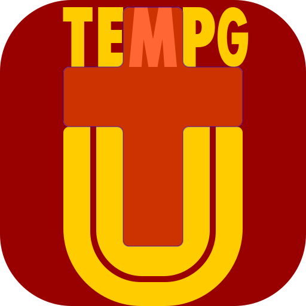
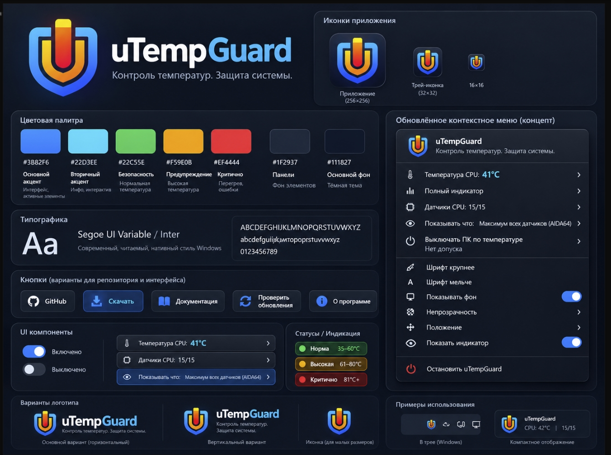
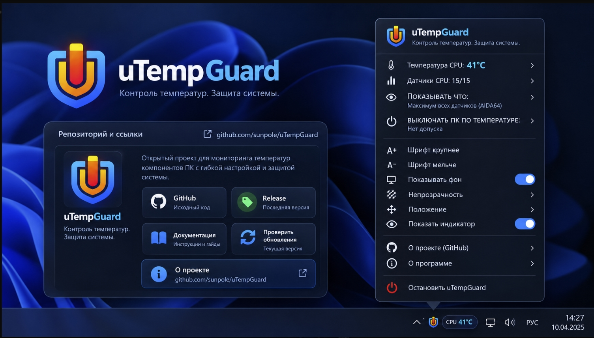

# uTempGuard

**Temperature monitoring for Windows, with optional and explicitly approved protective actions.**

[**Русский (primary)**](README.md) · **English**

[**⬇ Download ZIP**](https://github.com/sunpole/uTempGuard/releases/latest) · [**Installation**](docs/INSTALL_EN.md) · [**User guide**](docs/USER_GUIDE_EN.md) · [**All 28 SVG icons**](docs/ICON_CATALOG_EN.md)

---

## Overview

uTempGuard is a compact **Windows PowerShell 5.1 / WinForms** utility that reads temperature data exported by **AIDA64**, shows a real-time tray indicator, and can warn about high readings. Separately approved emergency actions are available but **disabled by default** on a new installation.

Python, Node.js and WebView2 are **not required** to run the application. AIDA64 is **not bundled**: you need your own installed, appropriately licensed copy with sensor export enabled.

## Features

**Two Windows views:** double-click the tray icon or `00_START-HERE.cmd` to open the main desktop dashboard with live verified readings and working settings shortcuts; right-click for the compact menu. Closing the dashboard **does not stop** the monitoring process. The promotional images below are **design concepts**, not pixel-perfect screenshots of the shipping WinForms dashboard.

| Capability | Details |
|---|---|
| Verified telemetry | CPU Package, cores and other available AIDA64 sensors, subject to freshness checks |
| Separate sensor selections | Different choices for the display and shutdown threshold |
| Temperature tray icon pack | 28 user-provided CorelDRAW SVGs; light/dark taskbar variants; 10°C buckets |
| Alert frames | Alternate normal/active images every 400 ms from 80°C while the PC is still running |
| Compact menu | Navigation, appearance, font, opacity, placement, language and links |
| Languages | Russian (primary), English; extensible JSON catalogs |
| Monitoring | Local status and event logs; fail-closed sensor handling |
| Safety | Observe-only defaults; no shutdown without independent explicit approval |

Historical design concepts, not screenshots of the current Windows application.

The [GitHub-rendered catalog of all 28 original SVGs](docs/ICON_CATALOG_EN.md) shows every image and clickable source filename. The [offline HTML icon gallery](docs/icon-gallery.html) lets you inspect all source SVGs, both taskbar themes, simulated temperatures and 400 ms alert animation without heating your hardware.

## Install in five steps

1. Visit [the latest GitHub Release](https://github.com/sunpole/uTempGuard/releases/latest) and download the attached **uTempGuard-vX.Y.Z-win.zip**, not GitHub's automatically generated source archive.
2. Extract it into a **permanent location**, such as `C:\Tools\uTempGuard`.
3. Double-click `00_START-HERE.cmd` or `Install-uTempGuard.cmd`. After installation, double-clicking `00_START-HERE.cmd` or `Open-uTempGuard.cmd` opens the desktop dashboard.
4. Provide the path to a valid signed FinalWire `aida64.exe`; configure AIDA64's sensor export as explained in the [installation guide](docs/INSTALL_EN.md).
5. Check the tray status after installation. The default is **Observe**: emergency power actions are never silently enabled.

**Updates:** A downloaded ZIP contains no Git metadata, so Git-based auto-updates work only in an actual **Git clone**. For ZIP installations, follow [manual upgrade instructions](docs/INSTALL_EN.md#upgrading-while-keeping-local-settings).

## Safety

- The current tested custom configuration uses 70°C warning and 75°C shutdown thresholds. **They are not universal safe limits for CPUs, GPUs or drives.**
- Forced Windows shutdown can destroy unsaved data and cannot be guaranteed if Windows or AIDA64 stops responding.
- An animation does not imply that emergency protection is armed.
- `config.json`, approvals, logs, credentials and local setup are never included in public source archives or release packages.
- The project does not modify BIOS, CPU voltage, clocks or cooling hardware.

## Resources

[Installation EN](docs/INSTALL_EN.md) · [User guide EN](docs/USER_GUIDE_EN.md) · [Install RU](docs/INSTALL_RU.md) · [Localization](docs/LOCALIZATION.md) · [Repository structure](docs/PROJECT_STRUCTURE.md) · [Tray icons](docs/TRAY_ICONS.md) · [Changelog](CHANGELOG.md) · [Issue tracker](https://github.com/sunpole/uTempGuard/issues)

For internal development context, see [docs/HANDOFF.md](docs/HANDOFF.md) and the [archived engineering README](docs/ARCHIVE_README_2026-10-25.md).

---

*Experimental user-developed Windows utility; not a substitute for hardware thermal protection. Check whether a LICENSE file has been added before reusing or redistributing code.*
